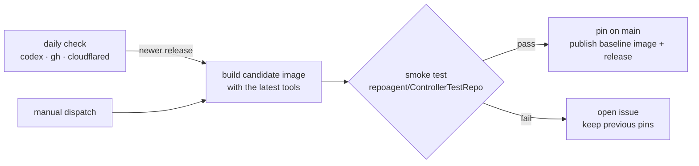

# Pin tools and update them only through a smoke-tested image

Accepted on 2026-10-24. Builds on [ADR 0010](0010-structure-the-controller-and-broker-as-ports-and-adapters.md).

A controller runs only the Codex CLI, GitHub CLI and cloudflared versions pinned in its image. The container runtime never updates them at startup. A new upstream release reaches operators as a new baseline image, published only after an end-to-end smoke test passes with exactly those versions. This smoke test is the test of our anti-corruption layers: the third-party tools change independently of us, and the adapters are not otherwise contract tested.

The smoke test runs against a dedicated private repository, `repoagent/ControllerTestRepo`, and the hosted credential broker:

1. Build a candidate image with the latest supported releases of the tools. The runner uses the same GitHub CLI version on the host.
2. Run `install.ps1 -Action Install -NonInteractive -Apply` in webhook mode with a quick tunnel: a fresh controller enrollment, then import into the container, configuration and start.
3. Post a Discussion that mentions the App.
4. Assert that the webhook arrives through cloudflared, the EYES receipt appears, and the agent's reply is posted as the App bot.
5. Clean up: delete the Discussion and revoke through `install.ps1 -Action Revoke`.

It runs when a tool has a newer release, and on manual dispatch, for example to check an installer change on a branch. It also covers the installer's main path on Linux. Interactive prompts, Windows and Azure hosting stay manual.

## Consequences

- `toolUpdates: latest` and `container/update_tools.py` are removed. Configurations saved with `latest`, or saved before the choice existed, run the image's pinned tools.
- cloudflared joins Codex and the GitHub CLI in the daily tool refresh.
- The smoke test needs a token for the `repoagent` account and an OpenAI API key, held as repository secrets. Only a run on `main` pins tools and publishes; any branch can run the smoke test, one run at a time.

Implementation: [#207](https://github.com/repoagent/controller/issues/207).
